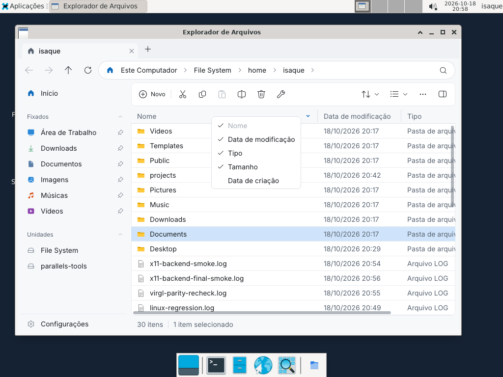

# File Explorer no Linux ARM64 (2026-10-18)

Validação na VM Parallels `Ubuntu24.04_arm64`, Ubuntu 24.04.5 LTS ARM64,
Xfce/Xorg, usuário `isaque`, Dart SDK 3.6.2. O projeto compartilhado pelo macOS
foi copiado para `/home/isaque/projects/dart_ui`, excluindo `.git`,
`.dart_tool`, `build`, `target` e referências locais. As dependências foram
resolvidas novamente nessa cópia. Nenhum worktree ou branch foi criado.

## Driver e Mesa

- GPU PCI Virtio (`1af4:1050`), módulo `virtio_gpu` carregado.
- Mesa EGL/GLX/DRI 25.2.8 (`25.2.8-0ubuntu0.24.04.4`).
- `glxinfo -B`: `direct rendering: Yes`, `Accelerated: yes`,
  renderer `virgl (Apple M4 (Compat))`.
- OpenGL 4.0, GLSL 4.00, OpenGL ES 3.0.
- O driver e o Mesa já estavam instalados e acelerados; não foi necessário
  substituí-los. O caminho validado usa X11/EGL/OpenGL, sem depender de Vulkan.

## Execução e defeitos corrigidos

O aplicativo abriu pela VM Dart e como executável AOT ARM64 com fontes e
ícones embutidos. Foi usado também `--backend=x11 --presentation=opengl`
para exigir esse caminho. A navegação por Ctrl+L atualizou a lista da pasta.

Os testes da janela revelaram defeitos do projeto:

1. `TranslateCoordinates` lia offsets 8/10, que pertencem ao XID filho.
   As coordenadas assinadas estão nos offsets 12/14. Isso deslocava menus
   quando o gerenciador reparentava a janela. A origem inicial também passa
   a refletir a posição solicitada antes de chegar um ConfigureNotify.
2. Um menu de contexto interno não consumia o clique secundário: o menu
   externo da área de arquivos abria também. Agora só o mais interno
   habilitado abre, mantendo a passagem dos demais gestos e dos menus
   desabilitados.
3. `X11Window.setCursor` apenas guardava um enum. Agora instala cursores
   nativos, reutiliza os recursos por conexão, restaura o cursor herdado da
   área de trabalho e libera os recursos ao encerrar. O cabeçalho mantém a
   seta horizontal durante todo o arraste.
4. Os menus arredondados deixavam pixels sem pintura nos cantos de janelas
   X11 opacas. Esses pixels agora recebem `theme.surfaceRaised`. Popups
   transparentes e menus desenhados dentro da janela conservam o alpha.
   Isso elimina o preto; não implementa um visual ARGB nem uma forma de
   janela arredondada no X11.

A imagem do cursor foi consultada pelo XFixes: ao passar do título para o
limite da coluna, mudou de 24×24 para 15×9; ao sair, voltou à imagem original.
O cursor permaneceu na forma horizontal durante um arraste de 60 pixels,
e a coluna acompanhou esse deslocamento. A janela também foi redimensionada
para 900×600, e o menu continuou ancorado no clique. O smoke nativo confirmou a origem `(48, 48)` de um popup override-redirect,
sua propriedade transient-for, apresentação CPU, teclado, tela e clipboard.



## Verificações

- Testes de regressão de menus aninhados, posição deslocada, menu desabilitado,
  pixels dos cantos, cursor, arraste e decodificação de coordenadas.
- No macOS, 418 testes dos arquivos afetados e backends envolvidos passaram,
  incluindo os testes das alterações de apresentação assíncrona e AppKit
  que já estavam no diretório de trabalho e foram preservadas.
- No Linux com display real, o lote final X11/menus/DataGrid/GL passou em
  426 testes, com uma omissão declarada pelo teste. O smoke X11 nativo também
  passou, incluindo a posição real do popup.
- A suíte completa sem display passou em 7.804 testes, com 907 omissões;
  o exemplo passou em seus 42 testes. A análise estática da raiz (`bin lib
  test tool`) e do exemplo terminou sem problemas.
- O build final produziu um ELF AArch64 com 12 recursos embutidos (6,2 MB),
  e o executável abriu com OpenGL exigido explicitamente. O cursor e o menu
  de colunas foram conferidos novamente nesse AOT.

As execuções completas passaram a ser feitas em sequência depois que duas
rodadas simultâneas encheram o disco temporário da VM. Os diretórios
`/tmp/dart_test.kernel.*` dessas rodadas interrompidas foram removidos e a
suíte completa foi repetida até o fim.

A repetição isolada dos dois arquivos abaixo confirmou 28 testes aprovados
e cinco falhas de paridade. Há uma limitação adicional descoberta pela execução ampliada com o driver
virgl: testes de paridade estrita CPU/GPU em
`test/differential/cpu_gpu_parity_test.dart` e
`test/rendering/gpu/gl_glyph_device_test.dart` encontraram diferenças máximas
de 1/255 em composição alpha. A tolerância zero foi mantida. A execução
funcional do explorador não prova paridade de pixels em todos os drivers.
Essa diferença de arredondamento não é a causa dos cantos pretos corrigidos.

A validação cobre esta VM e este desktop. Não demonstra compatibilidade com
todos os gerenciadores X11, Wayland, GPUs ou configurações de múltiplos monitores.

## Reproduzir

```sh
# Na raiz da cópia Linux, dentro da sessão gráfica:
dart pub get
dart analyze bin lib test tool
dart test test/widgets/context_menu_area_test.dart test/widgets/data_grid_test.dart test/backends/x11 test/rendering/gpu/gl_device_test.dart
dart run tool/x11_backend_smoke.dart
cd examples/file_explorer
dart pub get
dart analyze
dart test
dart run dart_ui build bin/file_explorer.dart --name "File Explorer" -o build/FileExplorer
./build/FileExplorer "$HOME" --lang=pt --backend=x11 --presentation=opengl
```
