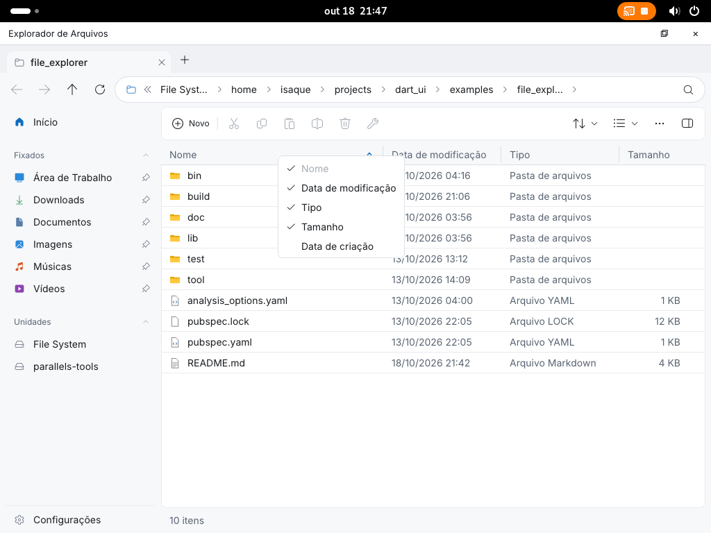

# GNOME Wayland e GPU no Ubuntu ARM64 (2026-10-18)

Ambiente: VM Parallels `Ubuntu24.04_arm64`, Ubuntu 24.04.5 LTS,
Dart 3.6.2, Mesa 25.2.8, renderer `virgl (Apple M4 (Compat))`.
Instalados GDM3, GNOME Session/Terminal, wayland-utils, libwayland-egl1,
libgbm1, PipeWire e WirePlumber. O Xfce/LightDM permanece instalado.
O display manager ativo passa a ser GDM; `WaylandEnable=true` mantém
GNOME Wayland. `eglinfo -B` confirmou EGL acelerado em Wayland e GBM.

## Apresentação nativa

A apresentação `wayland-opengl` cria contexto EGL sobre um dispositivo GBM,
desenha com o renderer OpenGL existente e exporta os planos dos buffers
GBM para o protocolo `linux-dmabuf` v3. Não há readback dos pixels por quadro.
Os imports são validados antes de aceitar a apresentação e reutilizados por
buffer. `wl_surface.frame` limita a produção; `wl_buffer.release` controla
quando o buffer pode voltar ao GBM. Ao redimensionar, o contexto GL é
preservado e os buffers antigos permanecem vivos até a liberação.

O transporte usa `params.create` assíncrono, permitindo recusar um import
sem encerrar a conexão. A seleção automática tenta GPU e mantém CPU como
alternativa. O teste nativo exige explicitamente a GPU para não esconder
falhas atrás dessa alternativa.

Essa arquitetura é prevista pelo [Wayland](https://wayland.freedesktop.org/docs/book/Architecture.html)
e pela extensão [EGL GBM](https://registry.khronos.org/EGL/extensions/KHR/EGL_KHR_platform_gbm.txt).
A validação cobre este driver e compositor; não comprova NVIDIA, múltiplas
GPUs, feedback de dispositivos/modificadores v4, sincronização explícita ou
escala fracionária. Não há garantia universal de ausência de cópia interna
no compositor.

## Menu gigante

A janela de popup era criada com o tamanho provisório da área de trabalho,
antes de medir o menu. O primeiro configure do compositor restaurava esse
tamanho e tornava o menu gigante. Agora a criação de `xdg_popup` espera a
medição; o positioner recebe tamanho, âncora, gravidade e ajustes reais.
Reposicionamento posterior usa xdg-shell v3 quando disponível.

A criação adiada não reserva IDs de protocolo antes de emitir seu pedido:
imports de GPU entre a preparação e a conclusão não deixam buracos nos IDs.
Descartar um popup ainda sem papel também não envia destroy para um objeto
que o compositor nunca recebeu.



## Seleção das opções do menu

Após corrigir o tamanho, clicar nas opções ainda fechava o menu sem executar
o comando. A causa estava em `MenuItemButton`: `closeChain()` destrói
sincronamente o estado de uma janela de popup, e a leitura posterior de
`widget.onPressed` lançava `StateError`. A função da ação agora é guardada
antes de fechar a cadeia e executada depois, preservando a ordem de fechamento.

O teste novo com `WindowPopupHost` reproduziu a exceção antes da correção e
passou depois. Ele exige que o comando rode exatamente uma vez, com a janela
já removida, sem erros da aplicação. O lote de menus, popups e DataGrid passou
em 97 testes. No AOT GNOME Wayland/OpenGL da VM, clicar em “Tipo” ocultou a
coluna e um segundo clique a reexibiu, com os dados das linhas acompanhando.

## Sessão para testes

A pedido do proprietário, o GDM usa `AutomaticLoginEnable=true` e
`AutomaticLogin=isaque`. No perfil de `isaque`, o bloqueio de tela está
desativado, `idle-delay` é zero e a suspensão por inatividade está definida
como `nothing` tanto na alimentação externa quanto na bateria.
A sessão atual foi desbloqueada com `loginctl unlock-session`.
Após reiniciar a VM, `loginctl` confirmou entrada automática de `isaque`,
`Type=wayland`, `State=active` e `LockedHint=no`; as preferências persistiram.
O encerramento normal parou durante a parada dos serviços e foi necessário
usar o reset do Parallels para concluir essa verificação.

## Verificações

- Análise estática de `bin lib test tool` e do exemplo: sem problemas.
- Suíte completa Linux sem display: 7.813 aprovados, 907 omissões declaradas;
  exemplo File Explorer: 42 aprovados. Execuções em sequência.
- Build AOT ARM64 concluído; executável aberto com
  `--backend=wayland --presentation=wayland-opengl`. Menu de colunas conferido
  por clique real via Mutter na posição solicitada, sem expansão da janela.
- Lote de regressão Wayland, popups, inicialização, GL e arquitetura:
  444 aprovados, 18 omissões de plataformas declaradas pelos testes.
- Smoke GPU real: 24 apresentações, oito imports, três redimensionamentos
  preservando o contexto; menu medido em 183×148 e submenu em 120×80.
- Smoke Wayland CPU: registro, configure, apresentação, frame callback,
  redimensionamento, decoração cliente, maximização e popups. O clipboard
  foi omitido na rodada após reiniciar por falta de um serial de entrada
  recente; o teste declara essa condição em vez de simular um sucesso.

As cinco diferenças de paridade estrita CPU/GPU de 1/255 já registradas
em [FILE_EXPLORER_LINUX_2026-10-18.md](FILE_EXPLORER_LINUX_2026-10-18.md)
continuam como limitação separada. As tolerâncias desses testes não mudaram.

## Reproduzir

```sh
# Dentro da sessão GNOME Wayland, na cópia local Linux:
dart run tool/wayland_backend_smoke.dart
dart run tool/wayland_gl_smoke.dart
cd examples/file_explorer
dart run bin/file_explorer.dart "$HOME" --backend=wayland --presentation=wayland-opengl
```
