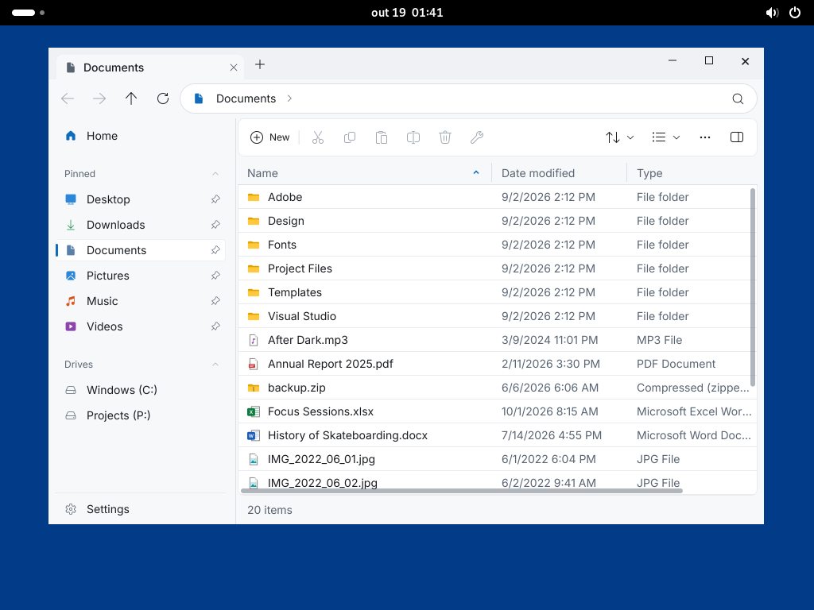
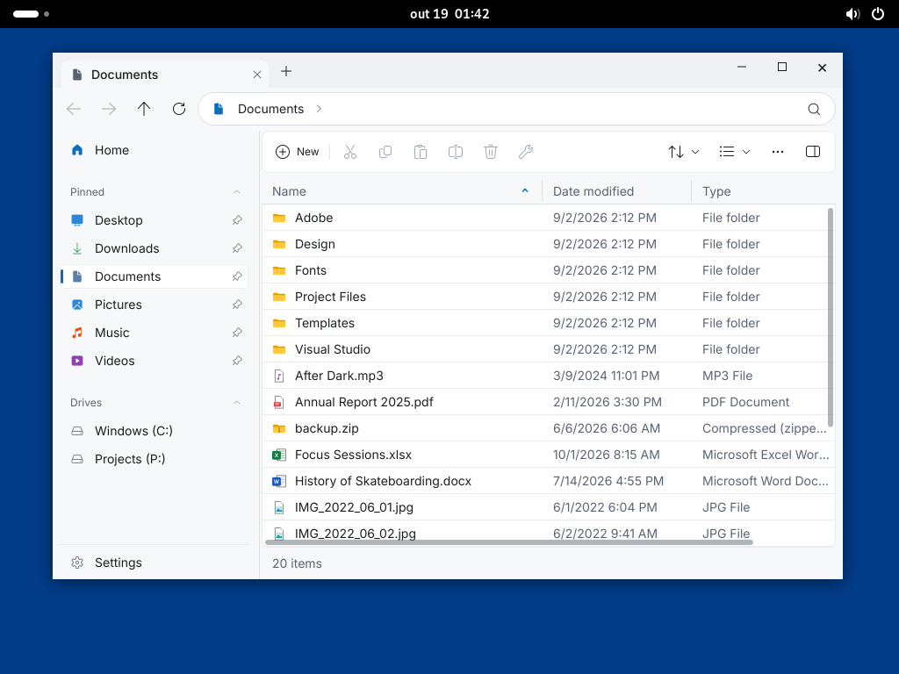

# Integrated Linux title strip — 2026-10-19

`WindowTitleBar.hidden` now integrates the file explorer tabs with window controls
on both native Linux backends. The existing `WindowDragArea` and caption widgets
are reused; no GTK, Qt or per-desktop implementation is involved.

## Windowing behavior

- Wayland hidden title bars do not create an xdg-decoration object or request SSD.
  The protocol's default self-decoration policy leaves the top strip to the app.
  Standard title bars retain existing SSD negotiation and CSD fallback behavior.
  Move/resize still use the existing xdg-shell seat/serial path, with cancellation
  of the application's pointer press when the compositor takes the interaction.
- X11 normal windows remain managed (`override_redirect=false`), with existing
  `_MOTIF_WM_HINTS` encoding requesting no server decorations. EWMH
  `_NET_WM_MOVERESIZE` carries the original physical root coordinates, button and
  direction. The XCB pointer grab is released before sending the request. A
  release missed by the WM sends CANCEL rather than leaving its grab stuck.
  The optional `_GTK_SHOW_WINDOW_MENU` message requests the WM's menu without
  loading GTK; window managers without that extension may ignore it.
- Caption geometry and state notifications update with configure and state
  events. Resize borders disappear when maximized/fullscreen; fullscreen removes
  caption buttons. Fixed-size windows disable maximize and interactive resize.
- The decoration wrapper preserves resize edges but does not add a second title
  row when the application supplies its own strip. Empty strip areas move the
  window; tabs and controls retain their own input. Double-click counting has a
  fallback for Linux backends that do not supply a native multi-click count.

## Validation

- Root analyzer clean. Directed backend, window widget and architecture suites:
  **767 passed** on macOS, Windows 11 ARM64 and Ubuntu 24.04 ARM64.
- Explorer analyzer clean; **74 passed, one platform-specific skip** on all three.
- AOT builds succeeded on all three systems and the applications were reopened.
- Native title-bar smoke on GNOME/Mutter Wayland + OpenGL and Xwayland + OpenGL:
  `TITLEBAR_STATES=PASS`, maximizing, restoring, entering/exiting fullscreen,
  and checking caption bounds after each transition without application errors.
- Native screenshots inspected below. Pointer routing, all eight X11 resize
  directions, double-click fallback, cancellation and unchanged standard windows
  are covered by automated tests. Manual drag via the Mac UI bridge could not be
  verified: that bridge returned stale Parallels guest images and its input did
  not produce an observable guest change. No KDE/XFCE/LXDE session was available;
  their compositor/window-manager decisions have not been tested directly.

## Protocol references

- https://gitlab.freedesktop.org/wayland/wayland-protocols/-/blob/main/unstable/xdg-decoration/xdg-decoration-unstable-v1.xml
- https://gitlab.freedesktop.org/wayland/wayland-protocols/-/blob/main/stable/xdg-shell/xdg-shell.xml
- https://specifications.freedesktop.org/wm-spec/latest/ar01s04.html#id-1.5.5
