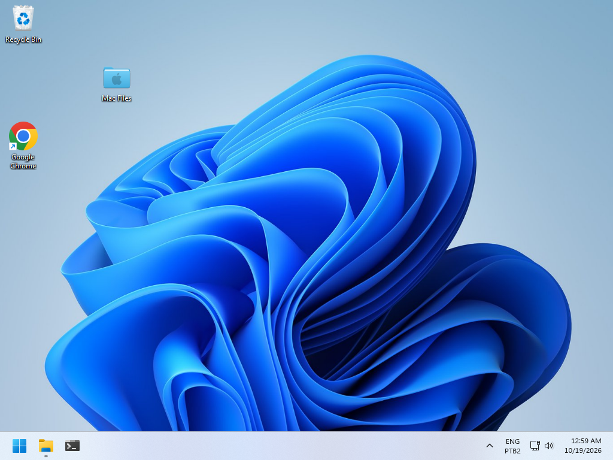

# Windows integrated title bar — 2026-10-19

The Win32 backend previously ignored `WindowTitleBar.hidden`. The Explorer
requested that option, but Windows still placed its regular title bar above
the application tabs. This was a backend gap, not a Dart restriction.

Win32 now exposes `HiddenTitleBarWindow` through the `ClientCaptionWindow`
capability. The client area extends into the caption while the native side
and bottom frame, window styles, shadow and system commands remain in place.
`WindowDragArea` draws accessible caption controls on this capability;
non-client hit targets remain HTMINBUTTON, HTMAXBUTTON and HTCLOSE. The
maximize target follows Microsoft's documented Snap integration contract.
Caption state notifications keep the restore glyph current independently of
changes in window width. Fullscreen clears the caption reservation.

The Explorer reserves space on the correct side of the tab strip: right on
Windows, left for macOS traffic lights. Tabs and their buttons retain their
own input; empty title-bar space starts a native move using the actual press
coordinates, supports double-click maximize/restore, and opens the system
menu on a secondary press. A move without a held primary press is refused.
Standard decorated windows and non-activating popups retain their existing
frame behavior. Missing DWM support falls back to the standard title bar.

Validation:

- macOS: clean framework/example analysis, 2,021 framework tests and 65 Explorer
  tests passed; AOT application rebuilt.
- Windows 11 ARM64: clean analysis; 32 caption/widget/architecture tests and 65
  Explorer tests passed; AOT executable rebuilt. Nine real-HWND tests passed
  in the logged-in desktop session, including caption hit targets, exact
  client sizing, top-edge resizing, maximize/restore, owned-dialog closure
  and fullscreen reservation. The separate broad widget/popup suite also
  passed (1,853 tests, two skips).
- Ubuntu ARM64: clean framework/example analysis; 32 directed tests and all
  65 Explorer tests passed.
- A real Direct3D 11 Explorer fixture was captured with tabs and all three
  caption controls on the same strip. The Snap flyout itself has not been
  visually verified; its required HTMAXBUTTON result is tested.

References: [DWM custom frames](https://learn.microsoft.com/en-us/windows/win32/dwm/customframe)
and [Snap support for custom Win32 captions](https://learn.microsoft.com/windows/apps/desktop/modernize/apply-snap-layout-menu).
